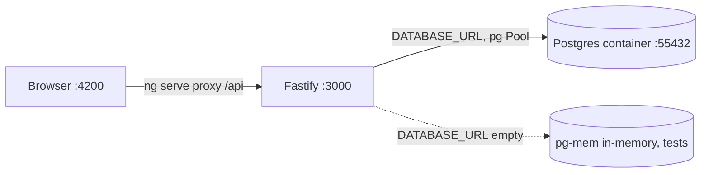

# System Patterns & Architecture

## System Overview
Full-stack e-commerce web platform for bookstore operations.

```mermaid
graph TD
    UI[Angular 17+ Frontend SPA] -->|HTTP / REST + JWT| API[Fastify Node.js Backend API]
    API -->|SQL Queries / Migrations| DB[(PostgreSQL Database)]
    API -->|OpenAPI / Swagger| DOCS[/docs interactive Swagger UI]
```

## Architectural Patterns
1. **Separation of Concerns:**
   - Presentation (Angular Standalone Components + Signals)
   - Business Logic & Orchestration (Fastify Services & Route Handlers)
   - Persistence & Relational Consistency (PostgreSQL Schema with Foreign Keys, Constraints, and Indexing)
2. **Stateless Authentication:**
   - JWT tokens passed via `Authorization: Bearer <token>`
   - Role and identity decoded in backend fastify hooks
3. **Database Portability & Testability:**
   - PostgreSQL DDL migrations and seed scripts
   - In-memory SQLite or mock pg-mem support for isolated fast unit/integration testing when live postgres instance is being initialized
4. **Resilient Checkout & Inventory Management:**
   - Atomicity during order placement: cart checkout creates order, line items, payment record, and updates inventory/gift points within a transaction.

## Local Runtime Topology

- Postgres runs from `compose.yaml` (Podman or Docker). `database/Containerfile` copies `schema.sql` + `seed.sql` into `/docker-entrypoint-initdb.d`, which Postgres runs only on the first start of an empty volume.
- Configuration comes from environment variables (`PORT`, `JWT_SECRET`, `DATABASE_URL`), so the same process can later run on OpenShift with Secrets/ConfigMaps.
- The dev proxy (`frontend/proxy.conf.json`) exists only in `ng serve`. A deployed build needs a reverse proxy or Route that sends `/api` to the backend.

